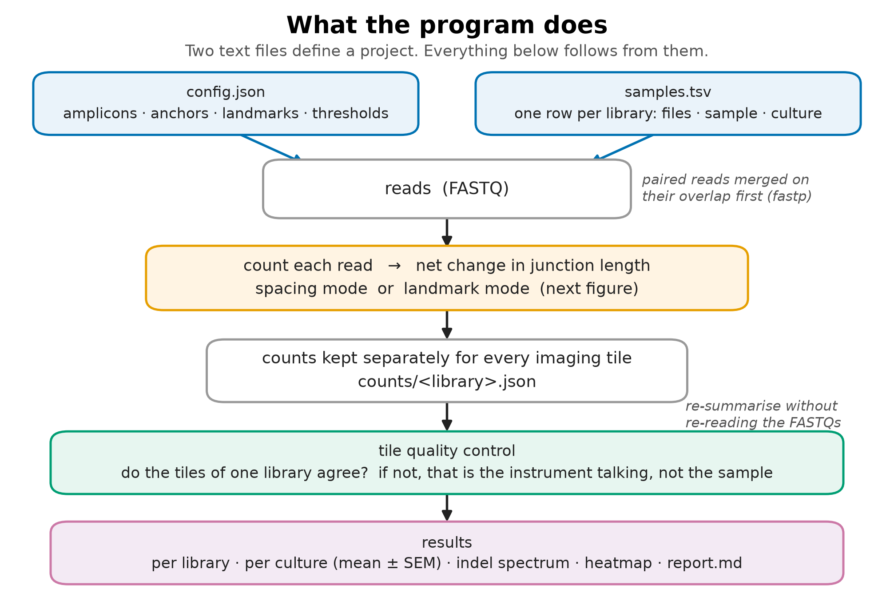
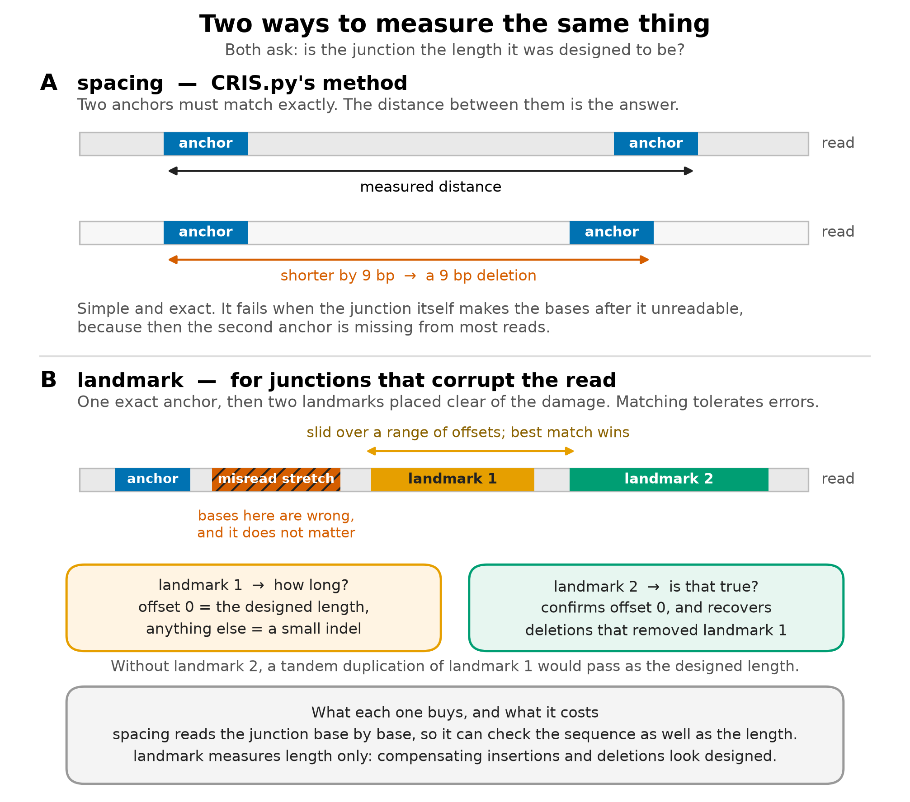

# jseq: junction sequencing for knock-in integration

Measures how often a knock-in junction has its designed length, from amplicon sequencing of the
5′ and 3′ junctions. It was written for a HITI knock-in study that is not yet published, and it
reproduces the JPH3 analysis in Benedetti et al., *Cell* 188 (2025), Figure S1F exactly. It needs
no one who wrote it: everything is set in two text files.



## Credit, licence and citation

The `spacing` counting mode is **CRIS.py's** method. CRIS.py is by Jon P. Connelly and Shondra M.
Pruett-Miller, at <https://github.com/patrickc01/CRIS.py>, released under GPL-3.0 and published as:

> Connelly, J.P., and Pruett-Miller, S.M. (2019). CRIS.py: a versatile and high-throughput analysis
> program for CRISPR-based genome editing. *Scientific Reports* **9**, 4194.
> doi:[10.1038/s41598-019-40896-w](https://doi.org/10.1038/s41598-019-40896-w)

This is not a fork and shares no code history with CRIS.py, but its spacing mode was written by
reading that program's source so that the counts match read for read, down to its convention of
ignoring an anchor found at read index 0. **It is therefore released under GPL-3.0 as well** (see
`LICENSE`). If you use this software, cite CRIS.py; `CITATION.cff` has both references.

What is new here is the `landmark` mode, for junctions whose own sequence corrupts the base calls
downstream of them, and the per-tile quality control.

## Project data

A project is two text files: a config and a sample sheet. The ones for the study this was written
for are not distributed with the code, because that study is not published yet; the scripts that
need them say so and stop. Everything else runs without them — the test suite uses a synthetic
project (`config/demo.json`) and the JPH3 example output is from published data.

Contents:

```
jseq.py              the program (counting, tile QC, tables, heatmap)
LICENSE              GPL-3.0; CITATION.cff has the references to cite
run_lsf.sh           run a whole project on an LSF cluster
run_local.sh         run a whole project on one machine
environment.yml      conda environment; environment.lock.yml pins the versions actually used
config/demo.json     synthetic project the test suite runs against (config/make_demo.py builds it)
config/jph3.json     JPH3 (2023) project, kept as a validation case
config/jph3_samples.tsv
tests/test_jseq.py   synthetic reads with known answers (runs in seconds, no data needed)
tests/regression.py  compares a finished run with previously delivered numbers and with 2023 JPH3
tests/portability.sh copies the package elsewhere and runs it on synthetic data end to end
tests/expected/      the numbers it compares against
validation/          the two checks behind the method choices: that the tile rule is not
                     circular, and what the confirm policy costs
docs/                the two figures below; make_figures.py redraws them
```

## What is measured

For each library, the **net-zero fraction**: of the reads that can be placed on the amplicon,
the percentage whose junction region has exactly the length of the designed junction. It is the
quantity CRIS.py reports as "indel 0" and the one plotted in the JPH3 figure.

It is a read fraction, not a cell fraction, and it is a length test, not a sequence test. A
read with a substitution, or with an insertion and a deletion of equal size, counts as
net-zero. The rest of each read is reported as a spectrum of length changes (`spectra.csv`)
and in the heatmap.

## Quick start (Janelia cluster)

1. Create the conda environment once, as a job (never on a login node):

   ```bash
   bsub -n 4 -W 1:00 -o env_%J.log 'mamba env create -f environment.yml'
   ```

2. Write a project config and a sample sheet (see below; copy `config/demo.json` and
   `config/demo_samples.tsv` and edit them). Check them without reading any data:

   ```bash
   python3 jseq.py check config/myproject.json
   ```

3. Run, from a login node (the script only submits jobs):

   ```bash
   export JSEQ_CONDA_SH=/path/to/miniconda3/etc/profile.d/conda.sh
   bash run_lsf.sh config/myproject.json /nrs/<lab>/<you>/myproject_out <LSF project code>
   ```

   A 24-library project of about a million reads each finishes in a few minutes.
   Results appear in `<out>/results/`. Start with `report.md`.

   The summary job only runs if **every** counting job succeeded. If it stays PEND after the array
   finishes, one of them failed: look in `<out>/logs/count_*.log`, fix it, and run the script again.
   Counts already on disk are reused, so a rerun only redoes what is missing.

Without LSF: activate the environment and run `bash run_local.sh config/myproject.json out/`.

## Inputs

### Sample sheet (tab-separated)

| column | meaning |
|---|---|
| `library` | unique name of the sequenced library, used for file names |
| `sample` | the biological sample (e.g. well 3) |
| `culture` | biological replicate, i.e. independent culture. Libraries with the same culture are averaged into one heatmap row and one point in the mean ± SEM |
| `amplicon` | which amplicon in the config this library is (e.g. `Demo_5p`) |
| `r1` | FASTQ (gzipped or not) |
| `r2` | read 2 FASTQ for paired-end data; leave empty for single-end reads |

When `r2` is given, the pair is merged with fastp first (overlap merging only; quality,
length and adapter filtering are off), and the merged reads are counted. Lines starting with
`#` are ignored.

### Project config (JSON)

```jsonc
{
 "project": "MyProject",
 "samples": "myproject_samples.tsv",        // path relative to this file
 "qc": {                                     // optional; these are the defaults
   "min_reads_per_tile_pooled": 1000,        // a tile needs this many reads (all libraries) for the tile rule
   "min_reads_per_tile_library": 5000,       // ... and this many in one library to enter its tile spread
   "max_tile_spread_pts": 2.0,               // tile QC fails above this spread
   "plateau_top_n": 8,
   "plateau_tolerance_pts": 1.0
 },
 "merge": {"overlap_len_require": 10, "overlap_diff_limit": 8,
           "overlap_diff_percent_limit": 25, "threads": 4},   // optional; defaults shown
 "amplicons": { "<name>": { ... }, ... },    // see the two modes below
 "heatmap": {"label": "MyProject",
             "rows": [{"amplicon": "MyProject_5p", "label": "5′"},
                      {"amplicon": "MyProject_3p", "label": "3′"}]}
}
```

Every amplicon has `reference` (the amplicon sequence, primer to primer), `mode`, `anchor`,
`strands` (`forward`, `reverse` or `both`; which strand of each read to search) and
`tile_filter` (`none`, `plateau`, or a list of tile numbers).

## The two counting modes




### `spacing`: CRIS.py counting

```json
"MyProject_3p": {"mode": "spacing", "reference": "...", "strands": "forward",
               "anchor": "CAATGCGTAAGTGCATATCG", "end_anchor": "CTTGAGTGCTGAGAGTTACT",
               "designed_junction": "TACAGCGTGCCAGGTGCAAGACGATTGTCCGACGACGCTT",
               "tile_filter": "none"}
```

A read counts when `anchor` and `end_anchor` both occur in it exactly. Its length change is
(end of `end_anchor` − start of `anchor`) in the read minus the same distance in the reference.
The denominator is the reads with both anchors. `designed_junction`, if given, is also
searched for exactly, giving CRIS.py's test-sequence percentage. This is CRIS.py v2's loop,
including its habit of ignoring an anchor that starts at the first base of a read, and it gives
CRIS.py's counts to the read (see Validation).

Pick anchors of about 20 nt in sequence that is read well, on either side of the junction and
far enough from it that indels do not reach them.

### `landmark`: for junctions that damage the reads

Some junction sequences corrupt the base calls that come after them in the read. At the junction
this was written for, the designed sequence is a perfect inverted repeat of a few tens of bases;
on a NextSeq 2000 the bases after it were miscalled often enough that the CRIS.py end anchor was
missing from most reads, and the missing reads were not random. Landmark mode avoids needing exact
sequence there:

```json
"MyProject_5p": {"mode": "landmark", "reference": "...", "strands": "forward",
  "anchor": "GACCATTGTGGTAAAAGTTC",
  "landmark1": {"seq": "<50 nt>", "offsets": [-60, 60], "min_match": 40},
  "landmark2": {"seq": "<42 nt>", "deletion_offsets": [-190, -56], "min_match": 33,
                "confirm": "veto", "min_base_quality": 30},
  "tile_filter": "plateau"}
```

Per read:

1. Find `anchor` exactly, upstream of the junction. No anchor: the read is not counted.
   Every read with the anchor is in the denominator, whatever happens next.
2. Slide `landmark1` (placed just past the corrupted stretch) over every offset in `offsets`
   from its reference distance to the anchor, and take the offset with the most matching
   bases (ties: the offset nearest zero). With at least `min_match` matches, that offset is the
   read's length change. Base errors in between do not matter, only the length.
3. Net-zero calls are checked with `landmark2` (the end of the amplicon), which should sit at
   its reference distance with at least `min_match` matches. Without this check a tandem
   duplication that copies landmark 1 would pass as net-zero (the tandem-duplication case in
   `tests/test_jseq.py`). A net-zero read that fails the check is one of three things:
   - *displaced*: landmark 2 is found at another distance, so the read is rearranged downstream
     of landmark 1 (`pct_landmark2_displaced`; it enters the spectrum at that length change);
   - *contradicted*: landmark 2 is not found anywhere, and more than `length − min_match` of the
     bases at its place that were read at quality ≥ `min_base_quality` disagree with it
     (`pct_landmark2_contradicted`). A read that ends partway through the landmark is judged on the
     part it does cover — a rearrangement is one of the things that pushes landmark 2 off the end of
     a read, so skipping short windows would be blind in exactly the cases this check is for;
   - *low quality*: neither; the end of the read is too poor to tell
     (`pct_landmark2_low_quality`).

   `confirm` decides what counts. `veto` (default): displaced and contradicted reads are not
   net-zero, low-quality reads are. `strict`: low-quality reads are unresolved as well.
   `off`: landmark 1 alone decides, as in the numbers delivered in November 2026.
   `veto` is the default, but counting a read whose amplicon end could not be read as net-zero is
   an assumption about that read, not a measurement of it. What supports the assumption: the
   low-quality share is set by the sequencer rather than the sample, varying by tens of points
   between tiles of one library while the sample does not, with low mean quality at those
   positions. How much it could cost: a small, measurable fraction of net-zero calls whose end IS
   readable prove rearranged, and if the unreadable ones are rearranged at the same rate, `veto`
   overstates a library by a few thousandths of a point. That is a sensitivity estimate conditional
   on the two groups being alike, which no data here can establish — not a bound. `strict` is the
   conservative choice and lowers each library by the size of the class rather than correcting it.
   `validation/policy_effect.py` computes all of this for your own data.
4. If landmark 1 is not found, search `landmark2` over `deletion_offsets`: a match there is a
   large deletion that removed landmark 1 (`pct_large_deletion`). Otherwise the read is
   unresolved.

`pct_net_zero_ceiling` assumes every unresolved read is net-zero, so the true value lies
between `pct_net_zero` and the ceiling (given that the classes are assigned correctly).

To set up landmark mode at a new junction: put the anchor in the genomic flank, read early in
the read; place landmark 1 (50 nt) where the per-position error rate has come back down after the
junction; make landmark 2 the last 40 to 50 nt of the amplicon; set both `min_match` to about
80% of the length; let `deletion_offsets` run from minus the distance between the cut and
landmark 2 up to just below landmark 1's offset range. The reads must reach landmark 2. A large
`pct_landmark2_low_quality` means the reads are too short or too poor at the end to check.

## Tile QC and the plateau rule

Illumina flowcells are imaged in tiles. A library is spread evenly over the tiles, so its
net-zero fraction should be the same on every tile within sampling noise. If it is not, the
tiles disagree because of the instrument, not the sample, and the number is not trustworthy.
For each library jseq reports `tile_spread_kept_pts` (max − min net-zero over its tiles with
at least `min_reads_per_tile_library` reads) and `tile_qc` = PASS or FAIL against
`max_tile_spread_pts`. JPH3 and the 3′ junction of the study project pass with all tiles.

At the 5′ junction of the study project, some tiles read the junction region far worse than
others. `tile_filter: "plateau"` handles this: pool all libraries of the amplicon per tile
(within one flowcell lane — lanes are never pooled), take the median net-zero rate of the best
`plateau_top_n` tiles as the plateau, and keep every tile at or above
`plateau − plateau_tolerance_pts`. The criterion is one-sided: a tile above the plateau is always
kept. Which tiles were kept, and the rate that decided each one, is in `tiles.csv`.

**The rule picks tiles by the quantity it then reports, so read this before using it on new data.**
On the run it was built for it is safe, and measurably so: pooling put the standard error of a
tile's value more than an order of magnitude below the tolerance, and holding out any single
library — or any whole culture — returned the identical tile set and moved that library by less
than a thousandth of a point. `validation/tile_rule_leakage.py` runs both checks on your own
data; run it before trusting the rule on a new experiment.

That safety comes from the libraries in the pool being alike, not from the rule itself. If the pooled
libraries genuinely differ, the rule will select on that difference: two libraries measured perfectly
but sitting at 80% and 20%, on different lanes of one flowcell, would have every tile of the first
kept and every tile of the second dropped. Lanes are therefore kept apart, and you should only pool
libraries you expect to behave alike. On new data, check that the tiles the rule drops look like worse
*measurement* — in `tiles.csv` and in the indel spectrum — and not simply like worse samples. If you
cannot tell the two apart, use `tile_filter: "none"` and report the spread instead.

### When tile QC fails

1. Look at `tiles.csv`. If a few tiles are far below the rest, set `tile_filter` to
   `plateau` and run `summarize` again (no recounting needed).
2. If the kept tiles still disagree, or almost none are kept, the junction sequence is
   interfering with sequencing. Check whether it is palindromic or otherwise unusual, consider
   landmark mode, and consider resequencing with single reads long enough to cover the whole
   amplicon in one read (that is how the 5′ data in the study project were recovered).

## Outputs (`<out>/results/`)

| file | content |
|---|---|
| `report.md` | tiles kept per amplicon, tile QC, per-culture table, pointers to the rest |
| `per_library.csv` | one row per library (columns below) |
| `per_culture.csv` | mean net-zero per culture; `ALL` row = mean, SD and SEM over cultures |
| `spectra.csv` | every length change seen, with read counts, per library (kept tiles only) |
| `tiles.csv` | pooled net-zero rate per tile and whether it was kept |
| `heatmap_by_culture.png/.pdf/.csv` | JPH3-style heatmap, one row per culture and junction |

`per_library.csv`: `reads_total` (all reads in the input), `reads_on_kept_tiles`,
`denominator` (anchored reads in landmark mode, reads with both anchors in spacing mode),
`pct_net_zero`; in landmark mode also `confirm_policy`, `pct_small_indel`,
`pct_large_deletion`, `pct_landmark2_displaced`, `pct_landmark2_contradicted`,
`pct_landmark2_low_quality`, `pct_unresolved`, `pct_net_zero_ceiling` and
`w1_tie_changed_reads` (reads where two landmark-1 offsets tied; jseq takes the one nearest
zero); in spacing mode `pct_designed_junction_exact`,
`pct_frame_preserving` (length change a multiple of 3, including 0) and
`pct_large_indel_gt10bp`; then `tiles_kept`, `tiles_total`, `tile_spread_kept_pts`,
`tile_spread_all_pts`, `tile_qc`. All percentages use `denominator`.

The mean ± SEM is over cultures, each culture being the mean of its libraries, so a culture
sequenced as six wells counts once, like a culture sequenced as one pool. In landmark mode a
heatmap row sums to less than 100%: unresolved reads stay in the denominator.

The intermediate per-library counts are in `<out>/counts/<library>.json`, per tile, so the
tile rule and the summary can be changed and rerun (`python jseq.py summarize ...`) without
reading the FASTQs again. Merged reads are kept in `<out>/merged/`.

## Validation

Run the tests after any change to `jseq.py`:

```bash
python tests/test_jseq.py                       # seconds, no data needed
bash   tests/portability.sh                     # ~1 min, needs fastp on PATH
python tests/regression.py delivered <out dir>  # after a full run of the study project
python tests/regression.py jph3    <out dir>    # after a full JPH3 run
```

`tests/test_jseq.py` has 14 tests on synthetic reads with known answers: wild type;
substitutions in the corrupted stretch (still net-zero); small insertions and deletions;
a large deletion that removes landmark 1; a tandem duplication of the cut through landmark 1 (not net-zero,
in a 300 nt read and in a longer one); poorly read against well-read mismatches at
landmark 2; the three `confirm` policies; CRIS.py's anchor rules; spacing mode against an
independent restatement of the CRIS.py loop on 3,000 randomly edited reads; the plateau rule;
and one end-to-end run including the heatmap. `tests/portability.sh` additionally copies the
package out of the project, builds a synthetic paired-end project in a scratch directory and runs
`run_local.sh` against it, which exercises the fastp merge and the config-driven path handling.

`tests/regression.py` on the real data, 2026-11-20, jseq 1.1.0, versions in
`environment.lock.yml`:

| check | result |
|---|---|
| JPH3, 6 libraries (the 2023 MiniSeq FASTQs behind Figure S1F) vs the 2023 CRIS.py CSVs | Total, indel-0 and designed-sequence read counts identical in all 6 |
| JPH3 per-culture means | 5′ 73.37 ± 1.58%, 3′ 68.04 ± 0.63% (mean ± SEM). The paper prints 73.4 ± 1.6 and 68.3 ± 0.7; the 0.3 pt 3′ gap is between the paper and its own CRIS.py output |
| JPH3 tile QC | all 24 tiles kept, every library passes (spread 0.65–1.40 pt) |
| The unpublished project's 3′ libraries, merged here from the raw read pairs, vs the numbers delivered earlier by other code | counted and net-zero reads identical in every library |
| Its 5′ libraries, single-end 300 nt, with the settings used for the delivered numbers (a fixed tile list; `confirm`: off) vs the original analysis script | every class count identical in every library; no tied reads |
| The same, with the package defaults (plateau rule, `confirm`: veto) | the plateau rule keeps every tile the earlier hand-picked list chose; no library moves materially, and the per-culture means are unchanged to the reported precision |
| Tile QC on that data | the 5′ amplicon passes on the kept tiles and fails badly on the full set, which is what the rule is for; the 3′ amplicon passes on all of them |
| Tile rule not circular | holding out any one library, or any whole culture, returns the identical tile set and moves that library by less than 0.001 pt; per-tile noise is far below the tolerance |
| Portability | the package copied to another directory, run from a third directory by `run_local.sh` on a synthetic paired-end project it had never seen, merges and counts correctly |

An independent review (Codex Astra, 2026-11-20, `reviews/astra/20261120_package/` in the parent
project) recounted all twelve raw 5′ libraries, all six JPH3 libraries and one 3′ library from the
raw reads and reproduced every stored per-tile count. It found the landmark-2 partial-window bug and
the two robustness holes fixed in 1.1.0; its report is worth reading before changing this code.

The outputs of these runs are in `example_output/` for comparison. The file paths recorded in
`example_output/jph3/` and in `config/jph3_samples.tsv` were rewritten to `data/jph3/...`
placeholders before publication; they were internal cluster paths. Nothing else in those files
was altered, so the counts there are the ones the checks above were run against.

## The Methods section

A manuscript-ready Materials and Methods describing this analysis is kept with the study it was
written for, not in this repository. It is generated from a JSON source file rather than edited as
a document, so that its numbers and the code cannot drift apart.

## Known limits

- Net-zero is a length test (see above). Where an inverted repeat corrupts the reads, as at the
  5′ junction this was written for, the junction cannot be checked base by base at all.
- Reads are assigned to tiles from Illumina read names (`instrument:run:flowcell:lane:tile:x:y`).
  FASTQs with other read names (e.g. from SRA) get one tile, `NA`, and no tile QC.
- PCR amplification bias between alleles of different lengths is not corrected, here or in
  CRIS.py.
- `strands: forward` assumes read 1 (or the merged read) runs in the reference's direction,
  as in these libraries. Use `both` if read 1 can start from either primer.
